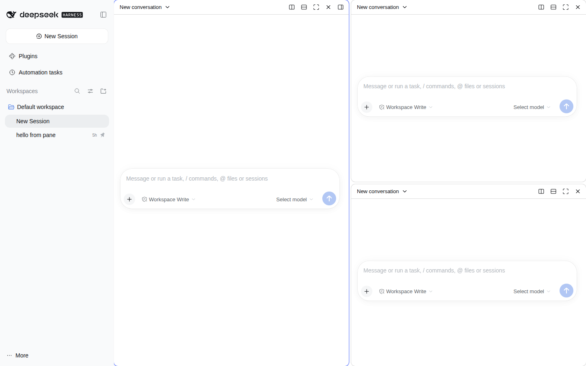

# dsh-conversation-split

[中文说明](./README.zh-CN.md)

Antigravity-style **split view** for [DeepSeek Harness](https://github.com/deepseek-ai/deepseek-harness) (DSH) Desktop / Web: show several conversations **side by side or stacked in the same window**, each with its own live chat, input box and streaming output.

It is a pure client plugin: it reuses DSH's own conversation renderer inside every pane (no iframes, no second app instance, no copy of the chat UI), so permissions, tool calls, attachments and session state behave exactly as in the normal single-conversation view.



## Features

- Split right / split down from the conversation header button, the pane toolbar, the sidebar session menu, or keyboard shortcuts.
- Up to 8 panes in a nested binary layout; drag the divider to resize.
- Per-pane title bar: switch conversation (searchable picker), new conversation, split, maximize / restore, close. Right-click the title bar for the full action menu.
- Drag a pane's title onto another pane (left / right / top / bottom half) to move it; swap via the action menu.
- Antigravity 2.24 behaviour: on narrow panes the toolbar is shown only while the pane is focused or hovered.
- Focus follows clicks; the focused pane's session is also the one the right sidebar (files, terminal, …) is attached to.
- Layout persisted in `localStorage`; panes whose session is deleted/archived become empty instead of dangling.
- English and Simplified Chinese UI, following the host locale.
- Modifier key follows the platform: ⌘ on macOS, Ctrl on Windows / Linux.

## Keyboard shortcuts

| Action | macOS | Windows / Linux |
| --- | --- | --- |
| Split right | ⇧⌘D | Ctrl+Shift+D |
| Split down | ⇧⌘E | Ctrl+Shift+E |
| Close pane | ⇧⌘W | Ctrl+Shift+W |
| Maximize / restore pane | ⇧⌘↵ | Ctrl+Shift+Enter |
| Next / previous pane | ⇧⌘] / ⇧⌘[ | Ctrl+Shift+] / Ctrl+Shift+[ |
| Focus pane left / right / up / down | ⌥⌘ arrows | Ctrl+Alt+arrows |

The commands are registered with DSH's shortcut service, so they appear in **Settings → Shortcuts** and can be rebound. When the host refuses a binding (DSH Web reserves many browser combinations, especially on Linux), the plugin falls back to a document-level key listener with the same defaults.

## Install

Requires DSH `0.2.x` (developed and tested against `@deepseek-ai/dsh@0.2.1-rc.2`). Plugins are installed into a DSH *profile*; the Desktop app uses the `desktop` profile, `dsh web` uses `web`.

```bash
# from npm (once published) …
dsh plugin --profile desktop add dsh-conversation-split

# … or from a local checkout
git clone https://github.com/locke-w/dsh-conversation-split
cd dsh-conversation-split && npm install && npm run build && npm pack
dsh plugin --profile desktop add ./dsh-conversation-split-0.1.0.tgz
```

Restart DSH Desktop (or `dsh web`) afterwards. If `dsh` is not on your PATH, use `npx -y @deepseek-ai/dsh@0.2.1-rc.2 plugin …`.

Remove with `dsh plugin --profile desktop remove dsh-conversation-split`.

## Platform support and verification status

- **Target platforms**: DSH Desktop on macOS (Apple Silicon / Intel) and Windows x64 — the platforms DSH Desktop itself ships for — plus `dsh web` in any desktop browser.
- **Verified so far**: `dsh web` 0.2.1-rc.2 in Chromium on Linux (splitting, per-pane chat input and message sending, picker, zoom, close, resize, drag/drop, header button, sidebar follow, locale, fallback shortcuts). The sidebar session-menu entry and Settings → Shortcuts registration are implemented but not yet exercised in that environment. Native macOS / Windows Electron builds have **not** been exercised yet; the plugin uses only the official client plugin API and platform-aware modifier keys, but please report anything that behaves differently on the Desktop app.

## How it works

- A `main.conversation` slot entry with priority `-1` shadows the host's single conversation while split view is active and renders only a placeholder box.
- A root-scoped `shell.overlay` entry positions the panes over that box. Each pane `retain`s its session through `ctx.sessions`, wraps it in the official `SessionProvider` and renders `conversation.content` with `variant: 'embedded'` — the same component the host uses.
- Layout is a tiny immutable binary tree (`src/layout/tree.ts`) with unit tests; the rest is React on top of DSH's slot kit.

## Development

```bash
npm install
npm test          # layout tree + storage tests
npm run typecheck
npm run build     # lib/index.js (host, empty) + lib/client.js (browser module)
```

## Limitations

- Pane sessions share the host's single right sidebar; it follows the focused pane.
- `dsh web` on Linux cannot register `Ctrl+Shift+<letter>` with the host shortcut service, so those bindings do not appear in Settings → Shortcuts there (the fallback listener still handles them).
- Not a `/fork` or `/branch` feature: panes show existing sessions; history is never duplicated.

MIT © locke-w
